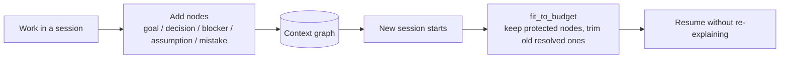

# AXON TREE

A Claude skill that carries session state — the goal, decisions, blockers,
assumptions, mistakes — across a long conversation and across new
sessions, as a **tree**, not a transcript, without you doing anything to
trigger it.

Formerly "Context Barrier." Renamed and rebuilt — see `CHANGELOG.md` for
exactly what changed and why.

## At a Glance

**What it does.** Keeps goals, decisions, blockers, assumptions and mistakes in a small tree so a new AI session can pick up where the last one stopped.

**Why it is useful.** Long AI chats lose context between sessions, and you re-explain everything. AXON loads only what matters within a word budget.



**What is different**
- Stores structure (decisions, blockers), not a transcript.
- Importance 3+ nodes are protected when trimming.

**Impact (Google XYZ).** Built a session-continuity skill, verified by 31 passing tests, by storing decisions and blockers as a structured graph that is trimmed to a word budget on resume.

**Verified 2026-11-08:** 31 tests passed (an earlier "54" counted a duplicate test file; removed). The ~57% token reduction in `benchmark.py` uses 3 hand-written examples and is illustrative, not a benchmark.

## What it does

- **Points, not paragraphs.** Explanations and the running memory are
  both point-form by default — shorter to read, cheaper in tokens. Ask
  for prose at any time and that instruction wins (see `SKILL.md` ->
  Priority Order).
- **A tree, not a flat map.** State is grouped by *what it's about*
  (goal / decisions / blockers / assumptions / mistakes), not by *when it
  was said* — so drift and "didn't we already decide this" are visible at
  a glance instead of buried at some turn number.
- **Auto-resume.** Claude appends a compact AXON TREE to its own replies
  every few exchanges. Paste that block to start a new session — in
  Claude or any other LLM chat — and it picks up where you left off.
- **Optional persistent graph.** In code-capable environments,
  `scripts/context_graph.py` stores the same tree as an actual node/edge
  graph on disk, so it survives across many sessions instead of one
  snapshot getting overwritten each time.
- **Grounding discipline.** Every response, not just the tree: flag real
  uncertainty, label what Claude added versus what the user said, never
  invent a specific to fill a gap.

## Compression — measured, reproducible

```
python3 benchmark.py
```

reproduces this on three illustrative before/after examples (explaining a
concept, resuming a coding session, summarizing a review):

| Scenario | Reduction |
|---|---|
| Explaining a concept | 64.5% |
| Resuming a coding session | 49.7% |
| Summarizing a code review | 56.1% |
| **Overall** | **57.0%** |

These are hand-written illustrative examples, not a blinded study — two
people writing the same pair would get different numbers, and it says so
in `benchmark.py`'s own docstring rather than only here. For your actual
session, run `context_graph.py stats` against your real graph instead of
trusting a canned percentage.

## Install

**Claude:** Settings -> Capabilities -> Skills -> upload this folder as
`axon-tree.skill`.

**Claude Code:** unzip so your skills directory contains `axon-tree/SKILL.md`.

**ChatGPT / Gemini / other chat LLMs:** paste `SKILL.md`'s rules once into
that platform's persistent-instructions field. After that it applies the
same way it does in Claude.

**Any other chat, one-off:** paste a previously exported AXON TREE as your
first message to resume there — no install needed for that alone.

## Using the graph store

```bash
python3 scripts/context_graph.py add-node --type decision --label "JWT in httpOnly cookies" --summary "Chosen over localStorage after an XSS finding" --importance 3
python3 scripts/context_graph.py add-node --type assumption --label "Staging/prod clock sync matches" --summary "Unconfirmed"
python3 scripts/context_graph.py confirm --id <node_id>
python3 scripts/context_graph.py resolve --id <node_id> --summary "Done and tested"
python3 scripts/context_graph.py compress
python3 scripts/context_graph.py prune --cold-keep 5
python3 scripts/context_graph.py fit --max-words 150
python3 scripts/context_graph.py export --style tree      # visual, matches the in-chat format
python3 scripts/context_graph.py export --style flat      # most token-efficient
python3 scripts/context_graph.py import saved_context.txt # either style round-trips
python3 scripts/context_graph.py validate
python3 scripts/context_graph.py stats
```

No required dependencies beyond the Python 3 standard library.
`benchmark.py` will use `tiktoken` for exact counts if it's installed and
reachable; otherwise it falls back to the same word-count heuristic
`context_graph.py` uses, and says so in its output.

## Running the tests

```bash
python3 -m unittest discover -s tests -v
```

23 tests, stdlib `unittest` only. Several exist specifically as regression
tests for bugs found in the previous draft — see `CHANGELOG.md`.

## What this doesn't claim

- Not hallucination-free. Nothing is, for any model.
- Not zero-setup on ChatGPT/Gemini/etc. — one paste into a persistent
  instructions field, once per platform.
- Not a fixed compression ratio on every input — a short session or a
  small graph won't have a fixed high percentage forced onto it at the
  cost of cutting something that mattered. Critical (importance >= 3)
  content is never cut by a word budget, full stop.
- Not a substitute for reading a source file at full fidelity — only the
  facts drawn *from* a file, once you're done with it, get compressed.
